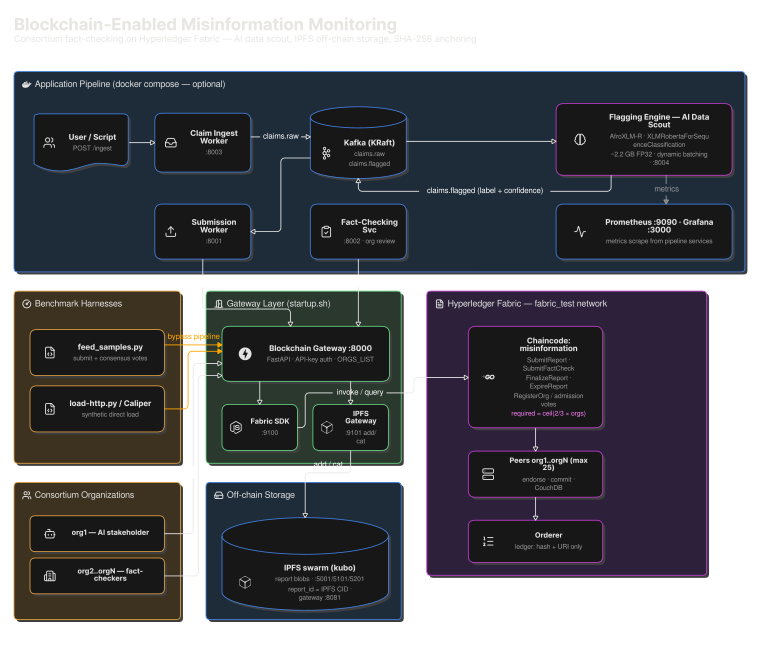

# A Blockchain Enabled Framework For Misinformation Monitoring

Consortium blockchain framework for monitoring misinformation. An AI model
(AfroXLM-R, an `XLMRobertaForSequenceClassification`) acts as a
potential misinformation data scout allowing for flagging of potential misinformation and escalating flagged reports to
a consortium of organizations who fact checks and vote on them via Hyperledger
Fabric. The chain anchors only a SHA-256 hash + off-chain URI per report; full
content lives in IPFS.

The prototype adds three things on top of that pipeline:

* a **public transparency portal**, where anyone can check whether a claim has
  been fact-checked, read the verdict with each organisation's reasoning and
  evidence, verify the record has not been tampered with, and submit tips
  anonymously;
* a **fact-checker workspace**, with a review queue per organisation, blind
  review, verdicts with reasoning and evidence links, a tamper check and ledger
  history;
* an **officials' console**, for stalled reports, consortium admission votes,
  the organisation's user accounts and a tamper-evident audit log;

all served over HTTPS behind a hardened edge, with individual accounts, roles
mapped onto Fabric ABAC identities, and authenticated service-to-service
traffic. See **[SECURITY.md](./SECURITY.md)** for the threat model, the
controls and the known limitations.

## Quick start: one command up, one command down

```bash
python3 up.py        # bring the whole system up (secure prototype, 3 orgs)
python3 down.py      # shut everything down and clean up
```

`up.py` checks the prerequisites and removes anything left from a previous run.
It downloads the Fabric binaries if they are missing, generates secrets, and
starts the Fabric network, chaincode, IPFS and gateways (`startup.sh --secure`).
It then starts Kafka, the AI pipeline, the fact-checking service, the web client
and monitoring, and waits until each one is healthy. At the end it prints where
to sign in. The first run downloads and builds everything, so it takes a while;
later runs reuse the images.

|Option|Effect|
|-|-|
|`--orgs N`|consortium size, 3 to 30 (default 3)|
|`--benchmark`|well-known API keys + validation load, for `feed_samples.py` / `load-http.py`|
|`--no-ai`|skip the flagging engine (2.2 GB model, ~3 GB RAM)|
|`--explorer`|also start Hyperledger Explorer|
|`--smoke`|finish by sending one tip through the whole pipeline to the ledger|
|`--demo`|web client on the in-memory mock ledger, no Fabric (light)|
|`--dry-run`|run the checks and show the plan without changing anything|
|`--status`|only list the running containers with their IP addresses and how to reach them|

When the system is up, `up.py` prints a table of every running container. It
shows the container's IP address on each Docker network, the host address and
port to open it on (marked `[this host only]` or `[public]`), the LAN address
for public ports, and the name other containers use to reach it. Container IPs
change when a container is recreated, so use the host addresses to connect.

`down.py` stops and removes every container, volume, network, chaincode image
and runtime file the system created. It never touches `results/`, `data/`, the
model weights or the Fabric binaries. `python3 down.py --purge` also deletes
the generated secrets and the built images, and `--dry-run` shows what would be
removed. Container names are fixed, so both scripts also replace containers of
the same name started from another clone of this repository.

Output is mirrored to `logs/up-<timestamp>.log`. The sections below describe
the same steps individually.

## How it works

The system has **two layers** that run independently:

### Blockchain layer (`./startup.sh`)

* **Fabric network**: peers/orderers/CouchDB on the `fabric_test` docker network
* **Chaincode** (Go, `blockchain/chaincode/misinformation/`): fact-check consensus model with **ABAC** (attribute-based access control)

  * **Roles** — every Fabric identity carries a `role` attribute (set at CA registration). Three roles control who can call which functions:

    | Role | Allowed functions |
    |------|-------------------|
    | `official` | `FinalizeReport`, `ExpireReport`, `VoteOnOrgAdmission`, `FinalizeOrgAdmission`, `SetFoundingOrgLimit` |
    | `fact_checker` | `Submit`, `SubmitFactCheck` (also `official` can call these) |
    | `observer` | read-only queries (`QueryReport`, `QueryAllReports`, etc.) |

    Role-bearing identities (`officialN`, `factcheckerN`) are registered via `register-roles.sh` through each org's Fabric CA during network setup.

  * `Submit` — an org submits a report (PENDING, 72h fact-check window)
  * `SubmitFactCheck` — another org records a verdict (`"0"`=non-misinfo, `"1"`=misinfo). **The submitting org cannot vote on its own report** (conflict of interest). After each vote the chaincode applies the consensus rule with
    `required = ceil(2/3 × registered_orgs)`:

    * **Early acceptance → FINAL**: once `tally["1"] >= required` (a 2/3 supermajority of YES).
    * **Early rejection → REJECTED**: once `tally["1"] + remaining_eligible < required`, where `remaining_eligible` counts registered orgs that have not voted, excluding the submitter. Even if every remaining org later votes YES, the threshold is mathematically unreachable, so the report is finalised immediately without waiting for the rest.
  * `FinalizeReport` — closes a **stalled** report by simple majority of the votes cast (≥2 fact-checks, no tie), and **only after its 72h window has closed**. While voting is open, only the 2/3 rule can reach FINAL, so a single official cannot cut a vote short.

    > **Changed in chaincode v2.3** (security hardening). The quorum formula is unchanged, and the benchmark harness already never lets the submitter vote, so FINAL/REJECTED outcomes are the same. A REJECTED report may now close up to one vote earlier, because the submitter is no longer counted as a pending voter. Results collected with v2.2 are in git history.
  * `ExpireReport` — expires PENDING reports past their deadline
  * `RegisterOrg` / `RequestOrgAdmission` / `VoteOnOrgAdmission` / `FinalizeOrgAdmission` — org governance (admission needs 2/3 of registered orgs)
* **Fabric Gateway SDK sidecar** (`:9100`, loopback): Node.js wrapper around `@hyperledger/fabric-gateway`. Each request names the role it acts under, and the sidecar signs with that org's matching identity (`officialN` / `fact_checkerN`). Requires the internal service token.
* **IPFS Gateway** (`:9101`, loopback): thin add/cat bridge over kubo; `/add` requires the internal service token
* **Blockchain Gateway** (`:8000`): FastAPI, the only thing orgs talk to. User accounts (JWT) and hashed, role-scoped API keys, role checks on every route, an audit log, IPFS storage, chaincode invocation, and the public read API

### Application pipeline (`docker compose up -d --build`)

* **Kafka** (KRaft, single-node): topics `claims.raw`, `claims.flagged`
* **Claim Ingest Worker** (`:8003`): accepts raw claim texts, publishes to `claims.raw`
* **Flagging Engine** (`:8004`): AI model, Kafka consumer/producer + dynamic batching + Prometheus metrics
* **Submission Worker** (`:8001`): consumes flagged claims, submits to blockchain gateway
* **Fact-Checking Service** (`:8002`): backend for the fact-checker workspace (review queue, blind review, votes); forwards the caller's own credential and holds none
* **Web client** (`https://localhost:8443`): the public portal, fact-checker workspace and officials' console, behind an nginx TLS edge. The only public entry point.
* **Prometheus** (`:9090`) + **Grafana** (`:3000`): monitoring (loopback; Grafana needs `admin` / `GRAFANA_ADMIN_PASSWORD` from `.env`)

The application pipeline routes claims as follows: `POST /ingest` into
claim-ingest-worker (`:8003`) publishes to the Kafka topic `claims.raw`; the
flagging-engine (`:8004`, `/predict`) consumes it and publishes
`claims.flagged`; submission-worker (`:8001`) consumes that and submits each
report to the blockchain gateway (`:8000`, IPFS + chaincode); fact-checking-
service (`:8002`) lets orgs vote until the report is FINAL or REJECTED. The
benchmark harnesses (`feed_samples.py`) bypass this pipeline entirely and
submit reports directly to the gateway — that is the quantity being measured.

### AI as data scout

The AI model processes incoming claims and flags potential misinformation.
Flagged reports are escalated to consortium organizations who independently
fact-check them. Two submission modes:

* **Direct mode (default)** :  org1 is the **AI stakeholder org**. It submits
  `--ai-pct%` of reports (the ones the AI processed); the remaining reports are
  submitted by a random `org2..orgN`. Every org except the report's submitter
  votes, so org1 votes on reports it did not submit. With `--ai-pct 100` org1
  submits everything.
* **Indirect mode** : a random org is chosen to submit every report — simulates
  a human-in-the-loop workflow where every org is a normal stakeholder.

## Architecture



## Repository layout

|Path|Purpose|
|-|-|
|`up.py` / `down.py`|one-command bring-up / teardown and cleanup of the whole system|
|`startup.sh`|blockchain layer: deploy + load + gateways (`--secure` for prototype mode)|
|`demo.sh`|web client demo without Fabric (mock ledger)|
|`SECURITY.md`|threat model, security controls, known limitations|
|`blockchain/scripts/gen-secrets.sh`|generates `.env` secrets + the edge TLS certificate (git-ignored, in `secrets/`)|
|`docker-compose.yml`|application pipeline: Kafka + services + monitoring|
|`benchmarks/`|`feed_samples.py` (pipeline + consensus sim), `load-http.py` (synthetic load), `caliper/` (Caliper suite)|
|`blockchain/scripts/`|deploy, bootstrap, gateway launchers, role registration|
|`blockchain/scripts/register-roles.sh`|Fabric CA role identity registration (official + fact_checker per org)|
|`blockchain/chaincode/misinformation/`|Go chaincode (fact-check consensus model + ABAC)|
|`blockchain/explorer/`|Hyperledger Explorer UI|
|`apps/blockchain_gateway/`|FastAPI gateway (`:8000`) — IPFS + chaincode|
|`apps/fabric_gateway/`|Node.js SDK sidecar (`:9100`)|
|`apps/ipfs_gateway/`|IPFS add/cat bridge (`:9101`)|
|`apps/claim-ingest-worker/`|Kafka producer, raw claims|
|`apps/flagging-engine/`|AI model + Kafka consumer/producer (`model/` weights)|
|`apps/submission-worker/`|Kafka consumer, submits to blockchain|
|`apps/fact-checking-service/`|fact-checker workspace backend (credential pass-through)|
|`apps/web-client/`|React web client + nginx TLS edge|
|`apps/kafka/`|Kafka broker (KRaft)|
|`monitoring/`|Prometheus + Grafana provisioning|
|`documentation/`|architecture diagrams, source formats|
|`data/`|test samples (git-ignored)|
|`results/local/`|benchmark CSVs (`http.csv`, `caliper.csv`, `real_loads.csv`)|
> Git-ignored: Python virtualenv, `blockchain/fabric-samples/`, `offchain.db`,
> `apps/flagging-engine/model/model.safetensors`, `data/`.

## Prerequisites

### System packages

|Tool|Why|Check|
|-|-|-|
|**Docker + Compose v2**|Runs peers/orderers/CouchDB/IPFS/Kafka/services|`docker compose version`|
|**Python 3.10+**|Gateway, bootstrap, loader script|`python3 --version`|
|**Go 1.22+**|Chaincode vendoring during deploy (tested with 1.24.0)|`go version`|
|**`curl`**|Pre-flight / verification|`curl --version`|
|**`jq`**|Chaincode lifecycle tooling|`jq --version`|
|**`git`**|Clone|`git --version`|

Docker images are pulled automatically on first run.

> Compose version:** use the modern Compose **v2** plugin. Legacy
> `docker-compose` v1.29.2 breaks the test network.

### Minimum RAM
The Fabric network (~100 MiB per peer | ~1 GB at 10 orgs),
Kafka (~512 MB), gateways/IPFS/monitoring, and the flagging-engine's 2.2 GB FP32
model. 
|What|Notes|
|-|-|
|Blockchain layer + benchmarks only|~2-3 GB|
|Full stack incl. flagging-engine (AfroXLM-R-large 2.2 GB FP32)|~5-6 GB|
 
## Platform compatibility

|Platform|Hosting the network|As an HTTP client|
|-|-|-|
|**Linux**|✅ fully supported|✅|
|**Windows**|✅ via **WSL2**|✅|
|**macOS**|⚠️ via a Linux VM (UTM/Lima/Colima/Docker Desktop)|✅|

## Setup

### 1. Clone the repo

```
git clone <your-repo-url> A_Blockchain_Enabled_Framework_for_Misinformation_Monitoring
cd A_Blockchain_Enabled_Framework_for_Misinformation_Monitoring
```

### 2. Provision `blockchain/fabric-samples/` (one-time)

```
cd blockchain/fabric-samples
curl -sSL https://raw.githubusercontent.com/hyperledger/fabric/main/scripts/bootstrap.sh \
  | bash -s -- 2.5.9 1.5.9
mv fabric-samples/test-network .
rm -rf fabric-samples
# Result: blockchain/fabric-samples/{bin,config,test-network}
```

### 3. Create the Python virtualenv (one-time)

```
python3 -m venv venv_A_Blockchain_Enabled_Framework_for_Misinformation_Monitoring
venv_A_Blockchain_Enabled_Framework_for_Misinformation_Monitoring/bin/pip install \
  -r apps/blockchain_gateway/app/v1-0-0/api/requirements.txt
```

### 4. Mint API keys (idempotent)

```
blockchain/scripts/bootstrap-keys.sh org1 org2 org3 ... orgN
# Creates: key-org1 -> org1 ... key-orgN -> orgN, stress-key -> org1
```

`startup.sh` / `deploy.sh` bootstraps keys for every org **and** calls
`register-roles.sh` to register ABAC role-bearing identities (`officialN`,
`factcheckerN`) via each org's Fabric CA — this step is only needed for a clean
manual setup.

### Accounts, keys and secrets

`gen-secrets.sh` (run by `startup.sh` and `demo.sh`) writes every shared
secret once to a mode-0600 `.env` at the repo root, which `docker compose`
reads automatically, and a self-signed certificate to `secrets/tls/`. Both are
git-ignored and never overwritten. Compose files refuse to start if a secret is
missing.

**People** sign in to the web client with individual accounts (`AUTH_MODE=jwt`,
the default). Each account belongs to one org and has one role:

|Role|Can|Signs on-chain as|
|-|-|-|
|`official`|everything below, plus finalise/expire stalled reports, admission votes, manage the org's users, read the audit log|`officialN`|
|`fact_checker`|review the queue, cast the org's vote with reasoning + evidence, escalate claims|`fact_checkerN`|
|`observer`|read only|— (queries only)|

The first official and fact-checker of each org are seeded automatically
(`official.orgN`, `checker.orgN`). Their **one-time passwords** are appended to
`secrets/initial-credentials.txt`, and each must choose a new password at
first sign-in. Officials create further accounts in the web console. From the
host:

```bash
docker exec -it blockchain-gateway python api/manage.py create-user --username thandi --org org2 --role fact_checker
docker exec -it blockchain-gateway python api/manage.py reset --username thandi    # new one-time password, 2FA cleared
docker exec    blockchain-gateway python api/manage.py list-users
docker exec    blockchain-gateway python api/manage.py verify-audit
```

There is no open self-registration (the old `POST /api/auth/register` is gone).
Accounts can enable TOTP two-factor authentication under *Your account*.

**Machines** use API keys (`X-API-Key`), stored hashed and scoped to an org and
a role. The submission worker's key (`SUBMITTER_API_KEY`) has the
`ai_submitter` role and can only submit reports.

|Mode|API keys issued|Use|
|-|-|-|
|`./startup.sh` (benchmark mode)|well-known `key-org1..N` and `stress-key` (role `official`)|the benchmark harnesses, unchanged|
|`./startup.sh --secure`|none (left-over well-known keys are revoked); no validation load|the prototype|

|Variable|Default|Description|
|-|-|-|
|`AUTH_MODE`|`jwt`|`jwt` = accounts + API keys; `bootstrap` = API keys only (legacy)|
|`ACCESS_TOKEN_TTL_S`|`900`|access-token lifetime (kept in browser memory)|
|`REFRESH_TOKEN_TTL_S`|`28800`|session lifetime (rotating HttpOnly cookie)|
|`MAX_FAILED_LOGINS` / `LOCKOUT_S`|`5` / `900`|account lockout|
|`GATEWAY_BIND`|`127.0.0.1`|set `0.0.0.0` to let remote benchmark clients reach `:8000`|
|`WEB_HTTPS_PORT` / `HSTS_MAX_AGE`|`8443` / `0`|edge port; HSTS for a real domain + certificate|

API sign-in, for scripting:

```bash
TOKEN=$(curl -sk https://localhost:8443/api/auth/login -H 'Content-Type: application/json' \
  -d '{"username":"checker.org2","password":"<password>"}' | jq -r .access_token)
curl -sk -H "Authorization: Bearer $TOKEN" https://localhost:8443/fc/claims/pending
```

### Quick demo without Fabric

To show or develop the web client on a laptop without the 5-6 GB stack:

```bash
./demo.sh up        # gateway on an in-memory mock ledger + fact-checking service + web edge, seeded
# open https://localhost:8443, sign in with secrets/initial-credentials.txt
./demo.sh down      # or: ./demo.sh reset  to forget the demo data
```

The mock ledger applies the chaincode's consensus and ABAC rules, but it is
**not a blockchain**, and the UI shows a banner saying so. Seeded votes say
they are demo data. Its container names match the full stack's, so stop that
first. For front-end work, `cd apps/web-client && npm install && npm run dev`
serves on `http://localhost:5173` and proxies `/api`, `/fc` and `/tips` to the
local services. Run the gateway with `COOKIE_SECURE=0` for that, since the
dev server is plain HTTP.

## Run it end to end

The system has **two layers** that start independently. Start the blockchain
layer first — the app layer depends on it being reachable.

### Step 0: Purge stale containers

```
python3 down.py
```

> Leftover containers from earlier consortium sizes repeatedly break builds
> and IPFS checkpoints. Always purge first. `down.py` removes only this
> system's containers (by name and by its Docker networks), not every
> container on the host.

### Step 1: Start the blockchain layer

```
./startup.sh --orgs 5 --test-samples 10 --skip-caliper          # benchmark mode
./startup.sh --orgs 5 --skip-caliper --secure                     # prototype mode (no well-known keys)
```

This runs 7 steps automatically:

1. Ensures Docker networks exist (`ensure-networks.sh`) and generates secrets (`gen-secrets.sh`)
2. Provisions the Fabric network (peers, orderer, channel, chaincode)
3. Starts IPFS + IPFS Gateway
4. Bootstraps API keys for org1..orgN (idempotent — safe to re-run)
5. Starts Fabric Gateway SDK sidecar + blockchain gateway, and seeds an official + a fact-checker account per org
6. Runs a validation load (10 synthetic requests to confirm the gateway works; skipped with `--secure`)
7. Optionally runs a Caliper benchmark (skip with `--skip-caliper`)

After this, the blockchain gateway is live at `:8000`. Scale the consortium
with `--orgs N` (default 3, **max 30**) — gateway keys, peers, orderer, and the
connection profile all follow automatically. Benchmark harnesses **auto-detect
the on-chain org count** via `GET /api/orgs`, so they always match the live
consortium regardless of what `--orgs` you provisioned. `startup.sh` sets the
`ORGS_LIST` for the gateways itself, so the gateway org map is always in sync
on this path (only the incremental path below needs a manual gateway restart).

### Step 2: Start Explorer (patched)

```
docker compose -f blockchain/explorer/docker-compose.yaml down -v
docker compose -f blockchain/explorer/docker-compose.yaml up -d --build
sleep 30
```

Verify Explorer sync (should show `lscc` fallback, no errors):

```
docker logs explorer 2>&1 | grep -i "error\|lscc\|sync" | tail -10
```

### Step 3: Start the application pipeline (optional)

```
docker compose up -d --build
```

Brings up Kafka, claim-ingest-worker, flagging-engine, submission-worker,
fact-checking-service, the **web client** (`https://localhost:8443`), Prometheus,
and Grafana. The browser will warn about the self-signed certificate until you
trust `secrets/tls/server.crt` or replace it with a real one. Sign in with an
account from `secrets/initial-credentials.txt`. The gateway services (`:9100`,
`:9101`, `:8000`) are **deliberately not part of this file** — they are
provisioned by `startup.sh` with the exact org count it deployed. Keeping them
out means an app-layer `docker compose up` can never recreate a gateway with a
stale/partial org map, which silently made every fact-check vote from orgs
beyond the default list fail (see [Troubleshooting](#troubleshooting)). The
flagging-engine's 2.2 GB model fits comfortably on a laptop.

> Kafka must be reachable at `kafka:9092` — `claim-ingest-worker`,
> `submission-worker` and the flagging-engine all fail hard at startup if it
> isn't (see [Troubleshooting](#troubleshooting)).
>
> **Engine warmup:** `flagging-engine` binds `:8004` *before* its model
> finishes loading (~1 min int8 quantize on CPU). Requests in that window get
> `Connection refused` / `Connection reset`; the service has `restart:
> unless-stopped`, so a Kafka hiccup on first boot self-heals. Don't feed until
> the `until …422` probe below prints `engine ready`.

### Step 4: Wait for all services

```
# Check gateway
curl -s -H "X-API-Key: stress-key" http://localhost:8000/api/status

# Check IPFS nodes
for p in 5001 5101 5201; do
  curl -s -X POST http://localhost:$p/api/v0/version >/dev/null \
    && echo "ipfs :$p OK" || echo "ipfs :$p DOWN"
done

# Wait for AI engine to be ready (returns 422)
until [ "$(curl -s -o /dev/null -w '%{http_code}' -X POST http://localhost:8004/predict -d '{}' 2>/dev/null)" = "422" ]; do
  sleep 5
done && echo "engine ready"
```

### Step 5: Feed data through the pipeline

```
python3 benchmarks/feed_samples.py \
  --data data/translated_masked_samples_test.json \
  --samples 10 \
  --ai-pct 70 \
  --mode direct \
  --reject-pct 20 \
  --seed 100
```

Results are appended to `results/local/real_loads.csv`.

|Flag|Purpose|Default|
|-|-|-|
|`--data`|JSON file with statements|`data/translated_masked_samples_test.json`|
|`--samples N`|Randomly select N samples|all|
|`--ai-pct P`|% of reports the AI processed (submitted by org1 in direct mode)|100|
|`--num-orgs N`|Override on-chain org count|**auto-detected** from `/api/orgs`|
|`--mode`|`direct` (org1 = AI stakeholder, submits ai_pct%, random orgs submit the rest, everyone-except-submitter votes) or `indirect` (random org submits each report)|direct|
|`--reject-pct P`|% of reports with sub-2/3 consensus (REJECTED)|0|
|`--fact-check`|Simulate fact-checking (consensus voting) after submission|**on**|
|`--no-fact-check`|Disable fact-checking|—|
|`--seed N`|Random seed for reproducibility|**100**|
|`--vote-pool N`|Max concurrent fact-check votes in flight per report (keep 1)|**1** (sequential — no Fabric MVCC conflicts)|
|`--endpoint`|Flagging-engine `/predict` base URL|`http://localhost:8004`|
|`--blockchain-api`|Blockchain gateway base URL|`http://localhost:8000`|
|`--output`|Output path (`.csv` for CSV, `.jsonl` for JSONL)|`results/local/real_loads.csv`|

**How it works:**

1. Loads JSON, randomly selects N samples
2. AI-verdict: if the model engine is reachable, `/predict` provides the label

   * confidence; otherwise the harness falls back to deterministic seeded draws
   (see [AI verdicts & confidence](#ai-verdicts--confidence))
3. Submission split — direct mode: `ai_pct%` submitted by org1, the rest by a
   random `org2..orgN`
4. Fact-checks one vote from each non-submitting org — subsequently polls
   `/api/reports/{id}/chain` until `FINAL` or `REJECTED`
   (all votes are cast first; the chain early-finalises the moment quorum is
   mathematically settled, so unneeded votes simply land on an already-closed
   report)
5. Outputs per-sample results to CSV + console summary

**Accepted vs Rejected:**

* **Accepted** (`FINAL`): fact-checkers reached `>= ceil(2/3 × registered_orgs)`
  YES votes — the report is finalised with label "1".
* **Rejected** (`REJECTED`): even if every remaining org voted YES the 2/3
  threshold is unreachable — e.g. 13 orgs (required 9): after 7 votes of which
  2 are YES, `tally[1] + remaining = 2 + 6 = 8 < 9`, so the maximum possible
  YES is 8 and the chain finalises rejection immediately; the remaining orgs
  never need to vote.

Both are on-chain with a `report_id` = **the IPFS CID** of the report blob.
Rejected reports are permanent evidence that consensus was attempted but failed.

### Step 6: Verify everything via API

```
# Check status (orgs, reports, blocks)
curl -s -H "X-API-Key: stress-key" http://localhost:8000/api/status

# Check report chain history
CID=QmfQxxokgmiia8A461KwMPCxzZxTpnxBoWSyrhNPzBq5hj
curl -s -H "X-API-Key: key-org1" "http://localhost:8000/api/reports/$CID/chain"

# Check full consensus lifecycle
curl -s -H "X-API-Key: key-org1" "http://localhost:8000/api/reports/$CID/history"

# Check IPFS content retrieval
curl -sL "http://localhost:8081/ipfs/$CID"

# Verify IPFS integrity
curl -s -H "X-API-Key: key-org1" "http://localhost:8000/api/reports/$CID/verify"
```

### Step 7: Check Explorer UI

```
Open http://localhost:8080
Login: exploreradmin / exploreradminpw
Navigate to: Network > Channels > mychannel > Blocks
```

### Growing the consortium on a live network (no reset)

`startup.sh --orgs N` always **rebuilds from scratch** — its `deploy.sh` tears
the network down first, so every `startup.sh` run starts a fresh ledger. To add
orgs to a **running** network without losing state, extend incrementally
(chain-level: peers, channel config update, chaincode re-commit with the new
`OutOf(2, Org1..OrgN)` policy):

```
export N=15                                # example: grow to 15 orgs

blockchain/scripts/add-orgs.sh --orgs "${N}"          # peers + channel config + chaincode re-commit
blockchain/scripts/register-orgs.sh --limit "${N}"    # on-chain org registry 1..N → drives /api/orgs + quorum
blockchain/scripts/bootstrap-keys.sh org1 .. org"${N}" # API keys for every org (idempotent)

# CRITICAL — recreate BOTH gateways with the new org list. Each gateway builds
# its org→MSP map + identity wallet from ORGS at container start, and both
# gateway compose files declare `ORGS=${ORGS_LIST}` with **no fallback**: an
# unset variable fails loudly at compose config time instead of silently
# deploying a partial consortium. (An older gateway with the default
# `org1..org5` would instead 400 every submit/vote from a higher org and send
# `fc` far below the 2/3 quorum — see Troubleshooting.)
export ORGS_LIST=org1,org2,...,org"${N}"
blockchain/scripts/start-gateway-service.sh up        # fabric-gateway SDK sidecar (:9100)
blockchain/scripts/start-blockchain-gateway.sh        # blockchain-gateway (:8000)

# refresh derived configs for the new org count
bash blockchain/scripts/gen-explorer-config.sh --orgs "${N}"
bash benchmarks/caliper/gen-caliper-config.sh --orgs "${N}" --samples 100
```

Quorum is recomputed automatically by the chaincode: `required = ceil(2/3 × N)`
(15 orgs → 10 YES votes), and `feed_samples.py` re-detects it via `/api/orgs` —
no manual org count anywhere. Note `add-orgs.sh` requires the org3 baseline
(org3 crypto) to exist, i.e. a prior `deploy.sh` run.

### Step 3: Feed data through the pipeline

```
python3 benchmarks/feed_samples.py \
  --data data/translated_masked_samples_test.json \
  --samples 200 \
  --ai-pct 70 \
  --mode direct \
  --reject-pct 20 \
  --seed 100
```

Results are appended to `results/local/real_loads.csv`.

|Flag|Purpose|Default|
|-|-|-|
|`--data`|JSON file with statements|`data/translated_masked_samples_test.json`|
|`--samples N`|Randomly select N samples|all|
|`--ai-pct P`|% of reports the AI processed (submitted by org1 in direct mode)|100|
|`--num-orgs N`|Override on-chain org count|**auto-detected** from `/api/orgs`|
|`--mode`|`direct` (org1 = AI stakeholder, submits ai_pct%, random orgs submit the rest, everyone-except-submitter votes) or `indirect` (random org submits each report)|direct|
|`--reject-pct P`|% of reports with sub-2/3 consensus (REJECTED)|0|
|`--fact-check`|Simulate fact-checking (consensus voting) after submission|**on**|
|`--no-fact-check`|Disable fact-checking|—|
|`--seed N`|Random seed for reproducibility|**100**|
|`--vote-pool N`|Max concurrent fact-check votes in flight per report (keep 1)|**1** (sequential — no Fabric MVCC conflicts)|
|`--endpoint`|Flagging-engine `/predict` base URL|`http://localhost:8004`|
|`--blockchain-api`|Blockchain gateway base URL|`http://localhost:8000`|
|`--output`|Output path (`.csv` for CSV, `.jsonl` for JSONL)|`results/local/real_loads.csv`|

**How it works:**

1. Loads JSON, randomly selects N samples
2. AI-verdict: if the model engine is reachable, `/predict` provides the label

   * confidence; otherwise the harness falls back to deterministic seeded draws
   (see [AI verdicts & confidence](#ai-verdicts--confidence))
3. Submission split — direct mode: `ai_pct%` submitted by org1, the rest by a
   random `org2..orgN`
4. Fact-checks one vote from each non-submitting org — subsequently polls
   `/api/reports/{id}/chain` until `FINAL` or `REJECTED`
   (all votes are cast first; the chain early-finalises the moment quorum is
   mathematically settled, so unneeded votes simply land on an already-closed
   report)
5. Outputs per-sample results to CSV + console summary

**Accepted vs Rejected:**

* **Accepted** (`FINAL`): fact-checkers reached `>= ceil(2/3 × registered_orgs)`
  YES votes — the report is finalised with label "1".
* **Rejected** (`REJECTED`): even if every remaining org voted YES the 2/3
  threshold is unreachable — e.g. 13 orgs (required 9): after 7 votes of which
  2 are YES, `tally[1] + remaining = 2 + 6 = 8 < 9`, so the maximum possible
  YES is 8 and the chain finalises rejection immediately; the remaining orgs
  never need to vote.

Both are on-chain with a `report_id` = **the IPFS CID** of the report blob.
Rejected reports are permanent evidence that consensus was attempted but failed.

### AI verdicts & confidence

* **With the engine up**: label/confidence come straight from
  `POST /predict` (`flagged`, `confidence`/`misinformation_probability`).
* **Without the engine** (it's down or you don't run it): the harness falls
  back to **deterministic seeded draws** — `label = rng.random() < 0.5`,
  `confidence = rng.uniform(0.5, 1.0)` from `--seed` (default 100). The
`model_label` CSV column records `fallback_random` for AI-pool rows and
`random` for non-AI-pool rows. These values are reproducible but **not**
model output or ground truth — the consensus/throughput results are
unaffected either way.

### Sanity check

```
curl -s -H "X-API-Key: stress-key" http://localhost:8000/api/status
# -> {"backend":"ipfs","ipfs_available":true,...}
```

## Benchmarking

All benchmarks save results as CSV files to `results/local/` automatically
(no extra flags needed). Timestamps are embedded as a column; runs **append**
rather than overwrite.

* `results/local/http.csv` — `load-http.py` results
* `results/local/caliper.csv` — Caliper benchmark results (one row per round)
* `results/local/real_loads.csv` — `feed_samples.py` results (one row per
  submitted report; columns include `org_count`, `samples`, `votes_cast`,
  `final_status`, `latency_ms`, model label/confidence)

### Load benchmark matrix

The throughput dataset is a **matrix of org counts × sample sizes**: one
`feed_samples.py` step per `<orgs, samples>` cell, with `samples ∈ {10, 50, 100, 150}` (each 310 rows) and `--seed 100` so every cell draws the
same sample pool for apples-to-apples latency scaling. The compiled final
dataset (see `final_data.csv`) spans org counts **{20, 15, 10, 3}** — **1,240
rows, 0 FAIL**, with a consistent 25 % `REJECTED` (from `--reject-pct 25`).
After purging and rebuilding for each org count (`docker rm -f` →
`startup.sh --orgs N` → `docker compose up -d --build`), feed all four step
sizes:

```
for S in 10 50 100 150; do
  python3 benchmarks/feed_samples.py \
    --data data/translated_masked_samples_test.json \
    --samples "$S" --ai-pct 50 --mode direct --reject-pct 25 --seed 100 \
    --endpoint http://localhost:8004 --blockchain-api http://localhost:8000 \
    --num-orgs N --output results/local/real_loads.csv
done
```

Each step appends to `real_loads.csv` **only on step completion** — a killed
step banks nothing and is replayed verbatim (same seed → same samples). With
the sequential `--vote-pool 1` default, a typical cell yields `fc = N-1` votes
(quorum `ceil(2N/3)`, ~25% REJECTED from `--reject-pct 25`) and **0 FAILs**.

**Compiling the final dataset** — `final_data.csv` at the repo root carries
every cell with normalised `samples` (the step size, recovered from each
write-batch row count) and `org_count`, aligned
`org_count → samples → timestamp`:

```
python3 - <<'EOF'
import csv
by = {}
for r in csv.DictReader(open('results/local/real_loads.csv')):
    r['org_count'] = r['org_count'].strip() or '10'      # older runs left it blank
    by.setdefault((r['org_count'], r['timestamp']), 0)
    by[(r['org_count'], r['timestamp'])] += 1
rows = [dict(r, samples=str(by[(r['org_count'], r['timestamp'])]))
        for r in csv.DictReader(open('results/local/real_loads.csv'))]
rows.sort(key=lambda r: (int(r['org_count']), int(r['samples']), r['timestamp']))
with open('final_data.csv', 'w', newline='') as f:
    w = csv.DictWriter(f, fieldnames=list(rows[0].keys()))
    w.writeheader(); w.writerows(rows)
EOF
```

### `feed_samples.py` (realistic pipeline + consensus)

Feeds real sample data through the pipeline with predetermined
acceptance/rejection rates — exercises the full submit + vote consensus path:

```
python3 benchmarks/feed_samples.py \
  --samples 500 --ai-pct 80 --mode direct --reject-pct 15 --seed 100
# -> results/local/real_loads.csv
```

### `load-http.py` (synthetic stress test)

Bypasses the AI pipeline entirely — sends synthetic reports directly to the
blockchain gateway:

```
python3 benchmarks/load-http.py --samples 200 --rw-mix 100
# -> results/local/http.csv
```

|Flag|Purpose|Default|
|-|-|-|
|`--base`|Gateway base URL|`http://localhost:8000`|
|`--samples N`|Total requests (fixed mode)|200|
|`--rw-mix P`|% writes vs reads|100 (all writes)|
|`--concurrency C`|Parallel workers|24|
|`--rate R`|Per-worker pacing (fixed mode)|25|
|`--rps R`|Stream mode: global target rate|off|
|`--duration S`|Stream mode: run for S seconds|off|
|`--label`|report_id prefix|`stress`|

### Caliper benchmark

```
# 1. (re)generate the connection profile + round sizes to match the LIVE consortium
benchmarks/caliper/gen-caliper-config.sh --orgs <N> --samples 100
#    (orgs MUST match the on-chain count; writes = samples*10 @25 TPS, reads = samples*10 @50 TPS)

# 2. run it
benchmarks/caliper/run-caliper.sh
```

Results: `benchmarks/caliper/report.html` + `results/local/caliper.csv`
(one row per round — write *and* read are both captured).

### Hyperledger Explorer

```
docker compose -f blockchain/explorer/docker-compose.yaml down -v
docker compose -f blockchain/explorer/docker-compose.yaml up -d --build
# open http://localhost:8080 — login exploreradmin / exploreradminpw
# (connection profile is regenerated by deploy.sh / gen-explorer-config.sh for the current org count)
```

> **Note:** The Explorer image is patched to handle Fabric 2.5.x (missing `lscc`
> system chaincode). The `Dockerfile` wraps the `lscc` call in try-catch so it
> falls back to `_lifecycle`. Use `--build` on first run or after any Explorer
> image update.

> **`priv_sk` symlinks:** Fabric CA and cryptogen both name keystore files with
> random hex; Explorer expects `priv_sk`. `deploy.sh` creates the symlink for
> all orgs automatically. If Explorer complains about a missing `priv_sk`, run
> `deploy.sh` again or manually symlink: `ln -sf *_sk keystore/priv_sk`.

> **Cert naming:** The connection profile (`networkConfig.json`) uses `cert.pem`
> (Fabric CA naming) for all orgs. `gen-explorer-config.sh` generates this
> automatically for the current org count.

Stop with the same compose file `down` (use `down -v` only to wipe Explorer's
own postgres/wallet data).

### Benchmarking without the AI model

The benchmarks measure **blockchain throughput per report** and never call the
model for that purpose — reports simply carry their AI verdict as data. The
flagging-engine is small (2.2 GB) and can run on the same host; you only need
to *skip* it if you'd rather not pay the model-load time or want a truly
minimal footprint:

1. `./startup.sh --orgs N ...` — chain + gateways + IPFS
2. `docker compose up -d` — Kafka + workers + flagging-engine all resident
   (~5-6 GB total)
3. Run any/all of the three benchmarks above

On a GPU box (e.g. 5090), run the fp16 CUDA server profile for fast inference:

```
docker compose -f apps/flagging-engine/docker-compose.yaml build \
  --build-arg TORCH_INDEX_URL=https://download.pytorch.org/whl/cu124
TORCH_DEVICE=cuda MODEL_QUANTIZATION=fp16 MAX_BATCH_SIZE=64 MAX_QUEUE_DELAY_MS=5 \
  docker compose -f apps/flagging-engine/docker-compose.yaml up -d
```

## Verifying a report end-to-end

```
CID=<report_id_from_csv>                       # CSV column report_id == IPFS CID

# on-chain record (status, consensus, votes)   — the ledger
curl -s -H "X-API-Key: key-org1" "http://localhost:8000/api/reports/$CID/chain"

# the report blob itself                       — the IPFS gateway (kubo :8081)
curl -sL "http://localhost:8081/ipfs/$CID"

# tamper-evidence check                        — hash + URI consistency
curl -s -H "X-API-Key: key-org1" "http://localhost:8000/api/reports/$CID/verify"

# full transaction history                     — Fabric GetHistoryForKey
curl -s -H "X-API-Key: key-org1" "http://localhost:8000/api/reports/$CID/history"
```

### Interpreting the `/chain` response

Returns the current on-chain record for a report. Example:

```json
{
  "id": "QmcA77cXb4koDoaeAw256dC7dSH3rrUMtM2rnsidispdJy",
  "content_hash": "73fa64843dd22e8b413d4c7f5c35946ba661632fbd887eec542cabf636072672",
  "inference_label": "0",
  "confidence": 0.573802,
  "model_version": "afro-xlmr-large-76L-misinfo-v1",
  "timestamp": "2026-09-18T22:47:32.509320Z",
  "submitted_by": "Org2MSP",
  "fact_check_deadline": "2026-09-21T22:47:32Z",
  "status": "FINAL",
  "fact_checks": [
    {"checker_msp": "Org3MSP", "outcome": "1", "txid": "09a21022..."},
    {"checker_msp": "Org1MSP", "outcome": "1", "txid": "e8e338c0..."}
  ],
  "final_label": "1",
  "finalized_by": "Org1MSP",
  "finalized_at": "2026-09-18T22:47:36Z"
}
```

| Field | What it tells you |
|-------|-------------------|
| `id` | IPFS CID — the report's globally unique identifier |
| `content_hash` | SHA-256 of `{source, inference}` — used for tamper detection |
| `inference_label` | ML model's initial guess: `"0"` = non-misinfo, `"1"` = misinfo |
| `confidence` | Model certainty (0.0–1.0) — values below 0.6 indicate uncertainty |
| `model_version` | Which ML model produced the inference |
| `submitted_by` | MSP ID of the org that submitted the report |
| `fact_check_deadline` | 72h voting window — after this the report can be expired |
| `status` | Lifecycle state (see below) |
| `fact_checks` | Array of org verdicts — each entry is one org's vote |
| `final_label` | Consensus result: `"0"` = verified non-misinfo, `"1"` = verified misinfo |
| `finalized_by` | Org that triggered finalization |
| `finalized_at` | When finalization occurred |

**Status values:** `PENDING` (no votes yet) → `UNDER_REVIEW` (≥1 vote) → `FINAL` (consensus reached) or `REJECTED` (mathematically impossible to reach consensus) or `EXPIRED` (deadline passed).

**What to look for:**
- `status: FINAL` with `final_label: "1"` = content verified as **misinformation**
- `status: FINAL` with `final_label: "0"` = content verified as **non-misinformation**
- `status: REJECTED` = fact-checkers couldn't reach 2/3 consensus — report is permanently marked as inconclusive
- `fact_checks` length < 2 with `status: UNDER_REVIEW` = still waiting for more votes
- `confidence` near 0.5 = the ML model was uncertain (borderline case)
- `content_hash` should match the IPFS document's `content_hash` (check with `/verify`)

### Interpreting the `/ipfs/{CID}` response

Returns the raw report document stored in IPFS. This is the off-chain blob containing the full claim text and AI analysis. Example:

```json
{
  "msg_id": "feed_25243384512c",
  "source": {
    "platform": "ai_scout",
    "content": "I-akhawunti esemthethweni ye-IEC ithe ward yethu ibhekene nokucishwa KAMANZI ngesikhathi sovoto...",
    "published_at": ""
  },
  "inference": {
    "label": "0",
    "confidence": 0.956888,
    "model_version": "afro-xlmr-large-76L-misinfo-v1",
    "inference_timestamp": "2026-09-18T22:47:38.840403Z"
  },
  "submitter": {
    "org_mspid": "Org2MSP",
    "submitted_at": "2026-09-18T22:47:38.840424Z"
  },
  "fact_check_status": "Pending",
  "fact_checks": [],
  "content_hash": "b7887c5d5849729bf4e4a8b60f1a8bbdd648fda326045240cfeb531202acc5f9"
}
```

| Field | What it tells you |
|-------|-------------------|
| `msg_id` | Claim identity carried from the ingest pipeline (NOT the report's own ID) |
| `source.content` | The original claim text being evaluated |
| `source.platform` | Where the claim originated (`ai_scout`, `twitter`, `facebook`, etc.) |
| `source.published_at` | When the claim was originally published (may be empty) |
| `inference.label` | ML model's classification: `"0"` = non-misinfo, `"1"` = misinfo |
| `inference.confidence` | Model confidence score (0.0–1.0) |
| `inference.model_version` | Which ML model produced the inference |
| `inference.inference_timestamp` | When the inference was made |
| `submitter.org_mspid` | MSP ID of the org that submitted the report |
| `submitter.submitted_at` | When the report was submitted |
| `fact_check_status` | Lifecycle: `Pending` → `Under_Review` → `Verified_Misinformation` / `Verified_Non_Misinformation` |
| `fact_checks` | Array of fact-check entries (empty until orgs vote) |
| `content_hash` | SHA-256 of `{source, inference}` — should match the on-chain value |

When populated, each `fact_checks` entry contains:

| Field | What it tells you |
|-------|-------------------|
| `checker_msp` | MSP ID of the fact-checking org |
| `outcome` | Verdict: `"0"` = non-misinfo, `"1"` = misinfo |
| `reasoning` | Free-text explanation (off-chain only, not on the ledger) |
| `support` | List of supporting URLs/references |
| `timestamp` | When the fact-check was submitted |

**Note:** The IPFS document evolves over time — each fact-check and finalization creates a new immutable IPFS object (new CID). Old versions remain permanently resolvable. The `report_id` field is deliberately excluded from the IPFS blob (it is the CID itself).

**What to look for:**
- `fact_checks[].reasoning` gives the human-readable justification (not available on-chain)
- `fact_checks[].support` provides evidence URLs for the verdict
- `content_hash` must match the on-chain `content_hash` — if not, the off-chain copy was tampered with
- `fact_check_status` should align with the on-chain `status` and `final_label`

### Interpreting the `/verify` response

Returns a tamper-evidence check comparing the off-chain IPFS document against the on-chain hash. Example:

```json
{
  "report_id": "QmcA77cXb4koDoaeAw256dC7dSH3rrUMtM2rnsidispdJy",
  "off_chain_intact": true,
  "matches_on_chain": true,
  "verified": true,
  "explanation": "The off-chain copy is unmodified AND its hash matches the immutable, consortium-voted hash stored on the ledger."
}
```

| Field | What it tells you |
|-------|-------------------|
| `off_chain_intact` | `true` = IPFS document hasn't been modified (re-hashed content matches stored `content_hash`) |
| `matches_on_chain` | `true` = IPFS `content_hash` equals the blockchain-anchored `content_hash` |
| `verified` | `true` = both checks pass — document is authentic and unmodified |
| `explanation` | Human-readable summary of the verification result |

**What to look for:**
- `verified: true` = the report is trustworthy — the off-chain document matches what was anchored on the blockchain
- `off_chain_intact: false` = the IPFS document was modified after submission (tampered)
- `matches_on_chain: false` = the off-chain copy was replaced with a different document entirely
- Both `false` = complete mismatch — the off-chain document is not the one that was submitted

### Interpreting the `/history` response

Returns the full transaction history for a report — every time it was modified on-chain. Example:

```json
[
  {
    "tx_id": "81a69f38e7944b91fe64922ac6625ca45fb8b60eb85fc8b635bccc926d216ff3",
    "timestamp": "2026-09-18T22:47:32Z",
    "is_delete": false,
    "record": {
      "id": "QmcA77cXb4koDoaeAw256dC7dSH3rrUMtM2rnsidispdJy",
      "status": "PENDING",
      "inference_label": "0",
      "confidence": 0.573802,
      "submitted_by": "Org2MSP",
      "fact_checks": []
    }
  },
  {
    "tx_id": "09a210221c66d7ef67375784e21d21b923ae1f1f97ba3eb1a518d9a6329a39f8",
    "timestamp": "2026-09-18T22:47:34Z",
    "is_delete": false,
    "record": {
      "id": "QmcA77cXb4koDoaeAw256dC7dSH3rrUMtM2rnsidispdJy",
      "status": "UNDER_REVIEW",
      "fact_checks": [
        {"checker_msp": "Org3MSP", "outcome": "1", "txid": "09a21022..."}
      ]
    }
  },
  {
    "tx_id": "e8e338c062c6f5c0d2fc22d3617c8f33efbe54df9337035d0aa20d16ad17eb25",
    "timestamp": "2026-09-18T22:47:36Z",
    "is_delete": false,
    "record": {
      "id": "QmcA77cXb4koDoaeAw256dC7dSH3rrUMtM2rnsidispdJy",
      "status": "FINAL",
      "fact_checks": [
        {"checker_msp": "Org3MSP", "outcome": "1", "txid": "09a21022..."},
        {"checker_msp": "Org1MSP", "outcome": "1", "txid": "e8e338c0..."}
      ],
      "final_label": "1",
      "finalized_by": "Org1MSP",
      "finalized_at": "2026-09-18T22:47:36Z"
    }
  }
]
```

| Field | What it tells you |
|-------|-------------------|
| `tx_id` | Unique Fabric transaction ID for this ledger write |
| `timestamp` | Blockchain timestamp (from the ordering service) |
| `is_delete` | `false` for all normal entries (reports are never deleted) |
| `record` | Full report state snapshot after this transaction |

**Lifecycle walkthrough (example above):**

| Entry | Time | What happened | Status | Fact-checks |
|-------|------|---------------|--------|-------------|
| 1st | `22:47:32` | `Org2MSP` submits content. ML model predicts non-misinfo (57% confidence). | `PENDING` | 0 |
| 2nd | `22:47:34` | `Org3MSP` submits verdict: **1** (misinformation). | `UNDER_REVIEW` | 1 (Org3MSP) |
| 3rd | `22:47:36` | `Org1MSP` submits verdict: **1** (misinformation). 2/2 votes = consensus. `Org1MSP` finalizes. | `FINAL` | 2 (Org3MSP, Org1MSP) |

**What to look for:**
- Entries are in **chronological order** — first entry is the original submission
- The **last entry's** `record.status` is the current on-chain status
- `record.fact_checks` grows with each entry — each new vote is appended
- If `record.status` is `UNDER_REVIEW` and `fact_checks` length < required votes, more fact-checking is pending
- The gap between timestamps shows how fast consensus was reached (seconds vs hours)
- `final_label` only appears in the entry where finalization occurred
- If `is_delete: true` appears, the key was deleted from the ledger (does not happen in normal operation)

## API quick reference

Through the web edge everything is same-origin: `https://localhost:8443/api/...`
(gateway), `/fc/...` (fact-checking service), `/tips` (public tip line). On
the host the services also listen on loopback ports.

Authenticate with `Authorization: Bearer <token>` (from `/api/auth/login`) or
`X-API-Key: <key>`. Every write is checked twice: by the gateway's role check,
and by chaincode ABAC on the role identity the gateway signs with.

### Blockchain gateway (`:8000`)

|Method & path|Purpose|Roles|
|-|-|-|
|`GET /api/public/info`, `/api/public/stats`|ledger backend, member count, quorum, verdict counts|public|
|`GET /api/public/reports?q=&verdict=&page=`|search/browse **closed** reports|public|
|`GET /api/public/reports/{id}`|verdict, per-org reasoning + evidence, integrity check, tx history|public|
|`GET /api/public/tips/{reference}`|status of a public tip|public|
|`GET /healthz`|liveness|public|
|`POST /api/auth/login`|sign in (`username`, `password`, `otp` if 2FA) → access token + refresh cookie|public|
|`POST /api/auth/refresh`, `/logout`|rotate / end the session (cookie + `X-Requested-With`)|session|
|`GET /api/auth/me`|who am I|any|
|`POST /api/auth/password`, `/mfa/setup`, `/mfa/enable`, `/mfa/disable`|own account|users|
|`GET/POST /api/users`, `PATCH /api/users/{u}`, `POST /api/users/{u}/reset`|manage own org's accounts|official (signed in)|
|`GET /api/status`|IPFS backend + ledger/auth mode|any|
|`POST /api/reports`|submit a report (`msg_id`, `label` 0/1, `confidence`, `model_version`, `content`, `source_platform`)|official, fact_checker, ai_submitter|
|`GET /api/reports`|list reports (optional `?status=PENDING`)|official, fact_checker, observer|
|`GET /api/reports/{id}`, `/chain`, `/verify`, `/history`, `/consensus`|off-chain doc, on-chain record, tamper check, tx history, quorum progress|official, fact_checker, observer|
|`POST /api/reports/{id}/fact-check`|the caller's org votes (`outcome` "0"/"1", `reasoning`, `support` = up to 10 http(s) URLs)|official, fact_checker|
|`POST /api/reports/{id}/finalize`|close a stalled report by majority (after the window)|official|
|`POST /api/reports/{id}/expire`|expire a report past its window|official|
|`POST /api/orgs/apply`, `/api/orgs/{msp}/admission`, `/vote`, `/finalize`|new-org admission workflow|official|
|`GET /api/orgs`, `GET /api/orgs/{msp}/admission`|registered orgs / admission status|official, fact_checker, observer|
|`GET /api/audit`, `/api/audit/verify`|own org's audit log / hash-chain check|official|

### Claim Ingest Worker (`:8003`)

|Method & path|Purpose|
|-|-|
|`POST /ingest`|queue claims (body: `{"claims": ["text1", ...]}`, at most 100); needs `X-API-Key: $INGEST_API_KEY`|
|`POST /public/tip`|one claim from the public (`{"claim": "..."}`, 10-2000 chars), rate-limited; via the edge at `/tips`|
|`GET /health`|health check|

### Flagging Engine (`:8004`)

|Method & path|Purpose|
|-|-|
|`POST /predict`|direct inference (body: `{"post_text": "..."}`); `X-API-Key` only if `PREDICT_API_KEY` is set|
|`GET /health`|health check|

### Fact-Checking Service (`:8002`, `/fc/` through the edge)

Forwards the caller's own `Authorization` / `X-API-Key` to the gateway.

|Method & path|Purpose|
|-|-|
|`GET /claims/pending?sort=&ai_label=&limit=&offset=`|open claims the caller's org may still vote on (not its own, not already voted)|
|`GET /claims/reviewed`|claims the caller's org has voted on|
|`GET /claims/{id}`|claim + consensus progress; other orgs' verdicts hidden until the caller's org has voted (blind review)|
|`POST /claims/{id}/fact-check`|vote (`outcome`, `reasoning` ≥ 20 chars, `support`)|
|`POST /claims/{id}/finalize`|finalise (official, after the window)|

## Teardown

`python3 down.py` does all of the following in one go (plus leftover containers,
chaincode images and volumes). The individual commands:

```
# Application pipeline (Kafka, workers, monitoring)
docker compose down

# Blockchain layer
blockchain/scripts/deploy.sh down
blockchain/scripts/start-ipfs.sh down
blockchain/scripts/start-ipfs-gateway.sh down
blockchain/scripts/start-gateway-service.sh down
blockchain/scripts/start-blockchain-gateway.sh down

# Explorer (optional)
docker compose -f blockchain/explorer/docker-compose.yaml down   # or down -v to wipe its DB/wallet
```

## Troubleshooting

|Symptom|Cause / fix|
|-|-|
|`ERROR: unknown flag` from `startup.sh`|Only `--orgs`, `--test-samples`, `--skip-caliper` and `--help` exist.|
|`ERROR: API gateway unreachable (HTTP 000)`|Gateway not running. Run `./startup.sh` first.|
|Gateway returns `401` on `/api/status`|API keys never seeded — run `bootstrap-keys.sh`.|
|`ERROR: --orgs must be a positive integer (got 'org1,...,orgN')`|A shell exported the CSV org list into the `ORGS` integer variable. The startup scripts use a separate `ORGS_LIST`; don't clobber `ORGS`.|
|`docker compose: variable "ORGS_LIST" is not set` / Gateway returns `400 unknown signing org` / `fc` far below quorum|The gateways build their org→MSP map + identity wallet from `ORGS_LIST` at container start, and the gateway compose files now declare `ORGS=${ORGS_LIST}` with **no default** — an unset variable fails loudly at config time (on an older gateway with the `org1..org5` fallback it instead silently re-scoped the consortium and every submit/vote from a higher org 400'd, dropping `fc` below the 2/3 quorum). Fix: `export ORGS_LIST=org1,...,orgN` then recreate **both** gateways (`blockchain/scripts/start-gateway-service.sh up` + `blockchain/scripts/start-blockchain-gateway.sh`). The shared key DB already holds every org's key — no bootstrap needed. The `startup.sh` path sets `ORGS_LIST` from `--orgs N` automatically; the failure above only happens when you invoke app-layer compose or the gateway scripts without the env.|
|Kafka down / workers stuck `Restarting`|Kafka crashed (see below) or was never started. Restart: `docker compose -f apps/kafka/docker-compose.yml up -d` (data in the `kafka-data` volume survives — the entrypoint only formats storage once).|
|Kafka keeps dying with `Unable to send a heartbeat ... timed out` in the logs|A transient KRaft controller-heartbeat stall fenced the single-node broker (crash under host pressure). The real gap: the compose file has **no restart policy**, so the crash was permanent. Fix: restart (`docker compose -f apps/kafka/docker-compose.yml up -d`), and add `restart: unless-stopped` (already applied) so it self-heals in future.|
|`WARNING: /predict returned 0: [Errno 111] Connection refused` / `[Errno 104] Connection reset by peer`|flagging-engine not ready yet: uvicorn binds `:8004` *before* the model load completes (~1 min int8 quantize on CPU), and a first boot can die on a Kafka ref-crash then self-restart (`restart: unless-stopped`). Wait for `Application startup complete.` in `docker logs flagging-engine` or run the `until …422` probe before feeding — the 104 case when Kafka is genuinely down is covered below.|
|`model_label` shows `fallback_random` / `random`|The engine wasn't reachable, so label/confidence were seeded deterministically rather than model output. Not an error.|
|Caliper CSV only shows the write round|Fixed in `run-caliper.sh` (it now parses the summary table that contains the `query-all-reports-read` row). Re-run to get both rounds per timestamp.|
|Caliper `networkConfig.json` / `ccp.json` mismatch with the chain|Regenerate for the live consortium: `benchmarks/caliper/gen-caliper-config.sh --orgs <N>` and/or `blockchain/scripts/gen-explorer-config.sh --orgs <N>`.|
|`ModuleNotFoundError: No module named 'config'`|`.gitignore` `con*` rule hid `config.py`. Fixed in `81ca586`; re-pull the branch.|
|Flagging engine crashes on startup|Two common causes: (1) missing `model/config.json` or `model.safetensors` — ensure both exist in `apps/flagging-engine/model/`; (2) Kafka unreachable — the engine hard-fails its lifespan if `kafka:9092` is down ("Unable to bootstrap", `Application startup failed`). Start Kafka first.|
|Kafka connection refused from containers|Services must use `kafka:9092` (not `localhost:9094`). Check `config.py` defaults.|
|`docker-compose` legacy v1 errors|Use Compose v2 (`docker compose`). Remove stale `fabric_test` network.|
|`x509: certificate signed by unknown authority`|`blockchain/fabric-samples/` not provisioned correctly. Re-run Step 2.|
|Explorer shows stale topology|Regenerate for the current org count and recreate: `blockchain/scripts/gen-explorer-config.sh --orgs <N>` then `docker compose -f blockchain/explorer/docker-compose.yaml up -d`.|
|Report stuck in `UNDER_REVIEW`|Fact-checkers haven't reached consensus yet, or deadline hasn't passed. Check `GET /api/reports/{id}/chain`.|
|Report shows `REJECTED`|Fact-checkers couldn't reach >= 2/3 consensus. This is working as designed — see early rejection logic.|
|IPFS nodes crash-loop with `Error: lock /data/ipfs/repo.lock: permission denied`|The named IPFS volume carries ownership from an earlier container generation. `docker rm -f` does **not** remove volumes: run `docker compose down -v --remove-orphans` (also wipes app-layer state + IPFS volumes; legacy standalone `ipfs-data` may survive) then purge + rebuild from `startup.sh`.|
|Runs stop silently after a Windows reboot / lid-close / sleep|WSL terminates detached processes; `feed_samples.py` writes its CSV **only on step completion**, so a killed run banks nothing — replay the same seed (`--seed 100`) and identical samples are re-fed. No corruption, partial steps are simply lost.|
|Builds fail intermittently (keepalive ACK timeouts, high load, `ipfs … did not become ready`) with swap exhausted|Restore swap: `sudo fallocate -l 8G /swapfile && sudo chmod 600 /swapfile && sudo mkswap /swapfile && sudo swapon /swapfile`. Note `sudo -n` (non-interactive) fails on this box — run such commands in an interactive shell.|
|`/api/auth/login` returns 400 "only available in JWT auth mode"|The gateway runs with `AUTH_MODE=bootstrap`. Unset it (the default is `jwt`) and restart the gateway.|
|401 "invalid or expired token"|Access tokens last 15 minutes; the web client renews them silently. Scripts should sign in again.|
|403 "password change required before continuing"|The account is still on its one-time password. Sign in to the web client (or call `POST /api/auth/password`).|
|423 on sign-in|Account locked after 5 failed attempts. Wait 15 minutes or have an official use *Reset access* (or `manage.py reset`).|
|`required variable ... is missing a value: run blockchain/scripts/gen-secrets.sh`|Secrets not generated yet. Run `blockchain/scripts/gen-secrets.sh` (startup.sh and demo.sh do it for you).|
|Fact-check returns 400 "... cannot fact-check it (conflict of interest)"|The org that submitted a report cannot vote on it. Working as designed.|
|Finalize returns 400 "still within its fact-check window"|Manual finalise only applies to stalled reports after the 72h window; during the window the 2/3 rule decides.|
|Remote benchmark client cannot reach `:8000`|The gateway listens on loopback by default. Start it with `GATEWAY_BIND=0.0.0.0`.|
|Browser certificate warning at `https://localhost:8443`|Self-signed certificate from `gen-secrets.sh`. Trust `secrets/tls/server.crt` locally, or replace both files in `secrets/tls/` with a real certificate.|
|`web-client` exits at start with `40-require-config.sh: ERROR`|nginx could not render its config or read the TLS files. Check that `secrets/tls/` exists and that `HOST_UID`/`HOST_GID` in `.env` match the owner of those files.|
|Submission worker logs "Dropping unsigned/forged claim"|A message on `claims.flagged` was not signed with `PIPELINE_FLAGGED_KEY`. All pipeline services must share the repo-root `.env`.|
|Apply org returns 400 "not registered on-chain"|The target org must be registered via `RegisterOrg` before `apply_org` can generate its API key. |
|IPFS nodes crash-loop with `Error: lock /data/ipfs/repo.lock: permission denied`|Run `docker run --rm -v ipfs_gateway_ipfs-data-1:/data -u root alpine chown -R 1000:1000 /data` (and `ipfs-data-2`), then `docker restart ipfs-node ipfs-node-1 ipfs-node-2`.|
|Explorer shows no blocks / sync errors|Use `--build` when starting Explorer: `docker compose -f blockchain/explorer/docker-compose.yaml up -d --build`. The patched image handles Fabric 2.5.x missing `lscc`.|
|ABAC rejection: "only official can call" / "only official or fact_checker can call"|The gateway's `GATEWAY_ROLE` identity doesn't have the required role. Check which role the endpoint needs (see [API quick reference](#api-quick-reference)) and set `GATEWAY_ROLE=official` or `GATEWAY_ROLE=fact_checker` in `apps/fabric_gateway/docker-compose.yaml`, then restart the gateway.|
|ABAC rejection on org4+|Role-bearing identities must be registered via `register-roles.sh` (called automatically by `deploy.sh` / `startup.sh`). If org4+ was added manually without running `register-roles.sh`, re-run it: `blockchain/scripts/register-roles.sh --limit <N>`.|
|Explorer `priv_sk` not found / wallet creation fails|`deploy.sh` creates `priv_sk` symlinks for all orgs automatically. Re-run `deploy.sh` or manually symlink: `ln -sf *_sk keystore/priv_sk` in the org's `msp/keystore/` directory.|